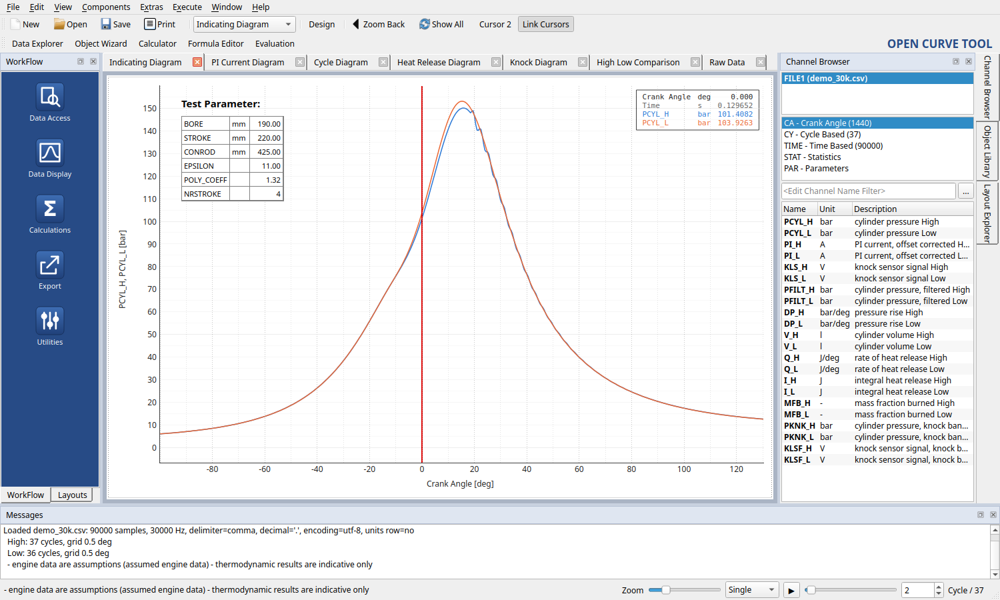

# Open Curve Tool

**Deutsch** · [English](README.md)

*Open-source desktop tool for combustion indicating analysis of two cylinders (High / Low):
cylinder pressure, heat release, knock, knock sensor and injector/valve current. Python, PySide6
and pyqtgraph; runs on Windows and Linux. The user interface is in English; the documentation is
available in German and in English.*



Auswertung von Indizierdaten für zwei Zylinder („High“ und „Low“): Zylinderdruck, Heizverlauf,
Klopfen, Klopfsensor und PI-Strom. Funktionsumfang und Bedienung sind an die klassische
Concerto-Oberfläche angelehnt. Die vollständige Beschreibung steht in
[SPEZIFIKATION.md](SPEZIFIKATION.md) (maßgebliche Fassung; englische Übersetzung:
[SPECIFICATION.en.md](SPECIFICATION.en.md)).

> **Stand:** frühe Version. Geprüft wurde bisher ausschließlich mit synthetischen Messungen; der
> Abgleich mit echten Messdaten und mit Concerto steht aus. Die voreingestellten Motordaten sind
> teilweise Annahmen (siehe unten).

## Installation

Python 3.11 oder neuer, unter Windows und Linux gleich:

```
python -m venv .venv
.venv/bin/pip install -r requirements.txt          # Windows: .venv\Scripts\pip install -r requirements.txt
```

## Start

```
python opencurve.py                         Oberfläche
python opencurve.py messung.csv             Oberfläche mit geladener Messung
python opencurve.py --batch messung.csv     Auswertung ohne Oberfläche
```

Der Stapellauf schreibt nach `<messung>_results/` (oder `--out`): Zykluskennwerte, Statistik,
mittlere Verläufe, Protokoll und einen HTML-Bericht mit Diagrammen. Weitere Optionen:
`--config motor.toml`, `--cyl H,L`, `--cycles 10:200`, `--no-plots`, `--save-cycles`, `-v`.
Rückgabewert 0 = ok, 1 = Eingabefehler, 2 = keine auswertbaren Zyklen.

## Eingabedatei

CSV mit den Spalten `Time, CA High, CA Low, DMR_L, DMR_H, PI_RM_L, PI_RM_H, KLS_H, KLS_L`
(Groß-/Kleinschreibung und Reihenfolge sind egal).
`Time` und die Kurbelwinkel sind Pflicht; `DMR_*`, `PI_RM_*` und `KLS_*` dürfen fehlen, dann
verringert sich nur der Auswertumfang des betroffenen Zylinders. Trenn- und Dezimalzeichen werden erkannt, die
Abtastrate wird aus `Time` bestimmt.

- `DMR_*`: Rohspannung in Volt, Voreinstellung 10 mV/bar (einstellbar je Zylinder)
- `PI_RM_*`: Strom in Ampere; ein konstanter Offset wird je Zyklus bestimmt und abgezogen
- `KLS_*`: Klopfsensor (Annahme: Körperschall in Volt); ausgewertet im Klopfband wie der Druck
- `CA *`: 0–720 °KW, der Wert 0 ist der Zünd-OT des jeweiligen Zylinders

## Bedienung in Kürze

| Aufgabe | Weg |
|---|---|
| Messung laden | `File > Open Measurement`, Datei auf das Fenster ziehen oder WorkFlow „Data Access“ |
| Kurve anzeigen | Kanal aus dem Channel Browser (rechts) ins Diagramm ziehen; rechter Rand = neue y-Achse, unterer Rand = neuer Achsbereich |
| Zyklus wählen | Zahlenfeld „Cycle“ und Schieberegler rechts unten; `Bild auf` / `Bild ab` blättern, `F5` spielt ab |
| Darstellung | Auswahlfeld in der Statuszeile: Single, Range, All, Mean, Envelope |
| Messcursor | Rote Linie ziehen oder Pfeiltasten; `F6` schaltet den zweiten Cursor zu |
| Zoom | Rechteck aufziehen, Mausrad; `Backspace` = Zoom Back, `Pos1` = Show All |
| Objekte anordnen | `F4` (Design), dann verschieben und an den Rändern ziehen |
| Eigenschaften | Doppelklick auf ein Objekt |
| Einstellungen | Menü `Extras`: Engine Parameters, Channel Scaling, Evaluation, PI Detection, Knock |
| Formelkanal | Symbolleiste „Calculator“ oder „Formula Editor“, z. B. `DIMEP [bar] = IMEP_H - IMEP_L` |
| Neu rechnen | `F9`; nach „Apply“ in den Einstellungen geschieht das automatisch |
| Export | `File > Export`: Seite als PNG/PDF, Kurvendaten als CSV, Ergebnisse und Bericht |

## Voreinstellungen, die zu prüfen sind

- **Motordaten:** Jenbacher Typ 6 mit Bohrung 190 mm und Hub 220 mm (veröffentlicht). Pleuellänge
  425 mm und Verdichtung 11,0 sind **Annahmen**. Solange „Engine data are assumptions“ gesetzt ist,
  kennzeichnet der Bericht die Thermodynamik-Kennwerte entsprechend.
- **Klopfschwelle:** 1,0 bar im Band 2–10 kHz ist eine Annahme.
- **Kurbelwinkelstufen:** Der ganzzahlige Dateiwert wird als „abgeschnitten“ gedeutet
  (`step_mode = floor`). Ist er gerundet, verschiebt das alle Winkel um 0,5 °KW; umstellbar unter
  `Extras > Evaluation`.

## Tests und Testdaten

```
python -m pytest tests                                       54 Tests, ohne Bildschirm lauffähig
python tests/make_testdata.py data/demo_30k.csv              synthetische Messung im Referenzformat
python tests/make_testdata.py data/demo_150k.csv --fs 150000 --duration 4
```

Zu jeder synthetischen Messung entsteht eine Datei `*_truth.json` mit den Sollwerten. Geprüft wurde
bisher ausschließlich mit synthetischen Daten; der Abgleich mit einer echten Messung und mit
Concerto steht aus.

## Lizenz und Hinweise

Copyright (C) 2026 System-M

Dieses Programm ist freie Software unter der [GNU General Public License, Version 3](LICENSE).
Es wird ohne jede Gewährleistung bereitgestellt; Ergebnisse sind vor einer Verwendung
eigenverantwortlich zu prüfen.

Open Curve Tool ist ein unabhängiges Projekt und steht in keiner Verbindung zur AVL List GmbH.
AVL und CONCERTO sind Marken ihrer jeweiligen Inhaber; das Projekt enthält weder Code noch Grafiken
aus deren Produkten.
