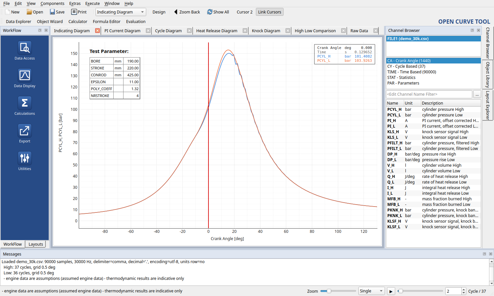

# Open Curve Tool

[Deutsch](README.de.md) · **English**

*Open-source desktop tool for combustion indicating analysis of two cylinders (High / Low):
cylinder pressure, heat release, knock, knock sensor and injector/valve current. Python, PySide6
and pyqtgraph; runs on Windows and Linux. The user interface is in English.*



Evaluation of indicating data for two cylinders ("High" and "Low"): cylinder pressure, heat
release, knock, knock sensor and PI current. Functionality and operation are modelled on the
classic Concerto user interface. The full description is in
[SPECIFICATION.en.md](SPECIFICATION.en.md) (English translation of the German reference
[SPEZIFIKATION.md](SPEZIFIKATION.md)).

> **Status:** early version. So far it has been verified only with synthetic measurements; the
> comparison with real measurement data and with Concerto is still open. The preset engine data
> are partly assumptions (see below).

## Installation

Python 3.11 or newer, the same on Windows and Linux:

```
python -m venv .venv
.venv/bin/pip install -r requirements.txt          # Windows: .venv\Scripts\pip install -r requirements.txt
```

## Start

```
python opencurve.py                         user interface
python opencurve.py measurement.csv         user interface with a loaded measurement
python opencurve.py --batch measurement.csv evaluation without user interface
```

The batch run writes to `<measurement>_results/` (or `--out`): cycle values, statistics, mean
curves, a log and an HTML report with diagrams. Further options:
`--config engine.toml`, `--cyl H,L`, `--cycles 10:200`, `--no-plots`, `--save-cycles`, `-v`.
Exit code 0 = ok, 1 = input error, 2 = no evaluable cycles.

## Input file

CSV with the columns `Time, CA High, CA Low, DMR_L, DMR_H, PI_RM_L, PI_RM_H, KLS_H, KLS_L`
(upper/lower case and column order do not matter).
`Time` and the crank angles are required; `DMR_*`, `PI_RM_*` and `KLS_*` may be missing, in which
case only the scope of evaluation of the affected cylinder is reduced. Delimiter and decimal sign
are detected, the sample rate is determined from `Time`.

- `DMR_*`: raw voltage in volts, default 10 mV/bar (adjustable per cylinder)
- `PI_RM_*`: current in amperes; a constant offset is determined per cycle and subtracted
- `KLS_*`: knock sensor (assumption: structure-borne sound in volts); evaluated in the knock band
  like the pressure
- `CA *`: 0–720 °CA, the value 0 is the firing TDC of the respective cylinder

## Operation at a glance

| Task | How |
|---|---|
| Load a measurement | `File > Open Measurement`, drag a file onto the window, or WorkFlow "Data Access" |
| Show a curve | Drag a channel from the Channel Browser (right) into the diagram; right edge = new y axis, bottom edge = new axis area |
| Select a cycle | Number field "Cycle" and slider at the bottom right; `Page Up` / `Page Down` step through, `F5` plays |
| Display mode | Selection box in the status bar: Single, Range, All, Mean, Envelope |
| Measurement cursor | Drag the red line or use the arrow keys; `F6` switches the second cursor on |
| Zoom | Draw a rectangle, mouse wheel; `Backspace` = Zoom Back, `Home` = Show All |
| Arrange objects | `F4` (Design), then move them and drag the borders |
| Properties | Double-click an object |
| Settings | Menu `Extras`: Engine Parameters, Channel Scaling, Evaluation, PI Detection, Knock |
| Formula channel | Tool bar "Calculator" or "Formula Editor", e.g. `DIMEP [bar] = IMEP_H - IMEP_L` |
| Recalculate | `F9`; after "Apply" in the settings this happens automatically |
| Export | `File > Export`: page as PNG/PDF, curve data as CSV, results and report |

## Defaults that need checking

- **Engine data:** Jenbacher Type 6 with 190 mm bore and 220 mm stroke (published). Conrod length
  425 mm and compression ratio 11.0 are **assumptions**. As long as "Engine data are assumptions"
  is set, the report marks the thermodynamic values accordingly.
- **Knock threshold:** 1.0 bar in the band 2–10 kHz is an assumption.
- **Crank angle steps:** The integer file value is interpreted as "truncated"
  (`step_mode = floor`). If it is rounded, all angles are shifted by 0.5 °CA; this can be changed
  under `Extras > Evaluation`.

## Tests and test data

```
python -m pytest tests                                       54 tests, run without a screen
python tests/make_testdata.py data/demo_30k.csv              synthetic measurement in the reference format
python tests/make_testdata.py data/demo_150k.csv --fs 150000 --duration 4
```

A file `*_truth.json` with the reference values is created for every synthetic measurement. So far
verification was done exclusively with synthetic data; the comparison with a real measurement and
with Concerto is still open.

## License and notes

Copyright (C) 2026 System-M

This program is free software under the [GNU General Public License, version 3](LICENSE).
It is provided without any warranty; results must be checked on your own responsibility before
they are used.

Open Curve Tool is an independent project and is not affiliated with AVL List GmbH. AVL and
CONCERTO are trademarks of their respective owners; the project contains neither code nor graphics
from their products.
